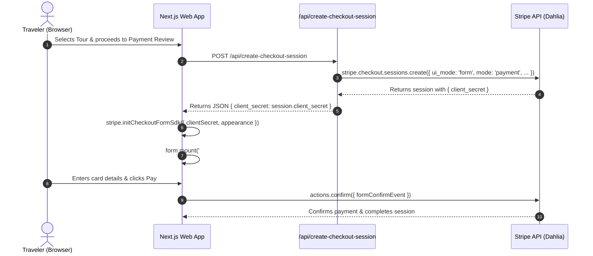

# Stripe Integration TODO & Implementation Guide

This document is the single source of truth for the embedded Stripe Checkout integration across **Daastaan-e-Pakistan**.

---

## Values to Replace

The placeholder has been replaced with the verified real Price ID from your Stripe test account.

**Files containing configuration:**
- [apps/web/app/api/create-checkout-session/route.ts](apps/web/app/api/create-checkout-session/route.ts)

| Field | Current Value | Product Name / Details | Status |
| :--- | :--- | :--- | :--- |
| `mode` | `payment` | One-time charge for tour booking | **Configured** |
| `line_items[].price` | `price_1UaAPIKPggU2D3Z1JLdXNNWX` | **Walled City Heritage Walk — 2,000 Years of Lahore** (£100.00 / GBP) | **Active & Verified in Stripe** |

---

## Configured Parameters

These parameters were configured in Checkout Studio and are already set correctly in the codebase.

**Files containing these parameters:**
- [apps/web/app/api/create-checkout-session/route.ts](apps/web/app/api/create-checkout-session/route.ts)

| Parameter | Value | Description |
| :--- | :--- | :--- |
| `ui_mode` | `form` | Embedded form mode rendered inside a Stripe-hosted iframe (Dahlia SDK). |
| `billing_address_collection` | `auto` | Automatically collects billing address if needed for card verification. |
| `phone_number_collection` | `{"enabled": false}` | Disables Stripe phone collection (handled natively in Daastaan checkout). |
| `automatic_tax` | `{"enabled": false}` | Disables automatic sales tax / VAT estimation in session params. |
| `payment_method_collection` | `always` | Automatically included when `mode` is set to `"subscription"`. |
| `submit_type` | `auto` | Displays default Stripe submit CTA based on session type. |
| `integration_identifier` | `custom_embedded_web_0001` | Unique integration identifier for Checkout Studio telemetry. |

---

## Setup and Next Steps

### 1. Environment Variables Configuration

Ensure the following variables are configured in `apps/web/.env.local` (local) and Vercel Project Settings (production):

```env
# Stripe Publishable Key (Browser-accessible)
NEXT_PUBLIC_STRIPE_PUBLISHABLE_KEY=pk_test_...

# Stripe Secret Key (Server-only)
STRIPE_SECRET_KEY=sk_test_...

# Stripe Webhook Secret (from Stripe Workbench)
STRIPE_WEBHOOK_SECRET=whsec_...
```

### 2. Project Structure of Integration Files

```
apps/web/
├── app/
│   ├── layout.tsx                                    # Loads Dahlia Stripe.js in <head>
│   └── api/
│       ├── create-checkout-session/route.ts         # Server endpoint: creates Checkout Session with Dahlia API
│       └── stripe/
│           ├── create-intent/route.ts                # Direct PaymentIntent fallback route
│           └── webhook/route.ts                      # Webhook listener (payment_intent.succeeded)
└── components/
    └── booking/
        ├── stripe-embedded-form.tsx                  # Client component: mounts checkout.createForm({ layout: 'expanded' })
        └── step-review-payment.tsx                   # Booking review step embedding the Dahlia form container
```

### 3. How the Integration Works



### 4. Testing with Stripe Test Cards

Use the following official test card credentials while in **Test Mode**:

| Card Type | Number | Expiry | CVC | Postal Code |
| :--- | :--- | :--- | :--- | :--- |
| **Standard Visa** | `4242 •••• •••• 4242` | Any future date | Any 3 digits | `90210` / `SW1A 1AA` |
| **MasterCard** | `5555 •••• •••• 4444` | Any future date | Any 3 digits | Any valid ZIP |
| **3D Secure Challenge** | `4000 •••• •••• 3063` | Any future date | Any 3 digits | Triggers simulated 3DS OTP modal |

### 5. Next Steps for Production

1. **Create Real Products & Prices**:
   - In Stripe Dashboard → [Products](https://dashboard.stripe.com/test/products), create your tour packages (e.g., "Walled City Walk - $45.00").
   - Copy the generated `price_...` ID and update `line_items[0].price` in `apps/web/app/api/create-checkout-session/route.ts`.
2. **Configure Webhook Endpoint**:
   - In Stripe Dashboard → [Workbench / Webhooks](https://dashboard.stripe.com/test/workbench/webhooks), add `https://daastaan-e-pakistan.vercel.app/api/stripe/webhook`.
   - Select event: `checkout.session.completed`.
   - Copy the Signing Secret into your Vercel `STRIPE_WEBHOOK_SECRET` environment variable.
3. **Fulfillment & Confirmation**:
   - In `checkout.session.completed` handler, query the database for the booking ID and trigger the Resend customer voucher and guide dispatch briefing.

---

## Developer Resources

- Official Stripe Support: [https://support.stripe.com](https://support.stripe.com)
- Stripe Documentation & MCP Guides: [https://docs.stripe.com/mcp](https://docs.stripe.com/mcp)
- Stripe Embedded Form Documentation: [https://docs.stripe.com/checkout/embedded/quickstart](https://docs.stripe.com/checkout/embedded/quickstart)
